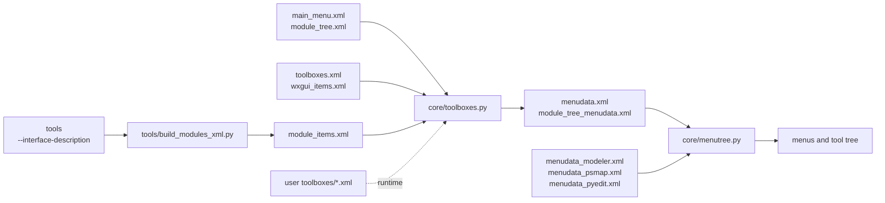
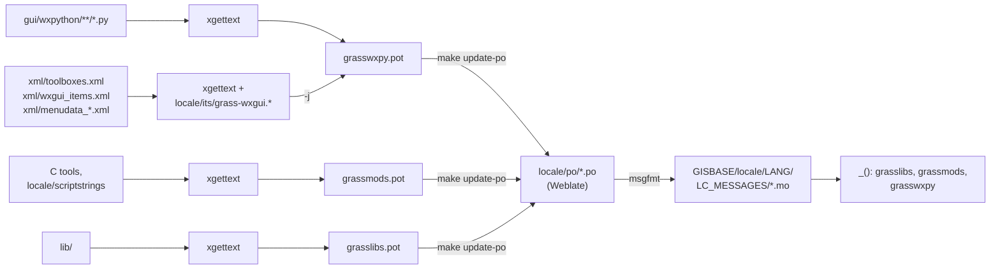

# wxGUI menus and their translation

This note describes how the menus of the wxGUI are defined, built and
translated. It covers the main menu, the tool tree (Tools tab), and the menus
of the Graphical Modeler, the Cartographic Composer and the Python editor.
Paths of wxGUI files are relative to `gui/wxpython/`, other paths to the
repository root.

## Source files

| File | Content |
| --- | --- |
| `xml/main_menu.xml` | Root of the main menu: the top-level toolboxes. |
| `xml/module_tree.xml` | Root of the tool tree, with the `<user-toolboxes-list/>` and `<addons/>` placeholders. |
| `xml/toolboxes.xml` | Toolboxes (menus) with their labels and items: `module-item` (a tool), `wxgui-item`, `subtoolbox`, `separator`. |
| `xml/wxgui_items.xml` | GUI items: label, handler or command, description, keywords. |
| `xml/menudata_modeler.xml`, `xml/menudata_psmap.xml`, `xml/menudata_pyedit.xml` | Complete menus in the final `menudata` format, read as they are. |
| `xml/*.dtd` | Structure of each file type. |

## Build and runtime

At build time, with the C locale (English):

1. `tools/build_modules_xml.py` writes `module_items.xml` with the
   description and keywords of every tool, taken from its interface
   description. For a tool with a label, the description is the label and
   the description joined with a space.
2. `core/toolboxes.py` combines `main_menu.xml` (or `module_tree.xml` with
   the `module_tree` argument), `toolboxes.xml`, `wxgui_items.xml` and
   `module_items.xml` into `menudata.xml` (or `module_tree_menudata.xml`).
   It expands subtoolboxes, fills each item with the data of the item of the
   same name (elements already in the item take precedence), adds handlers,
   and converts the tags to the `menudata` format (`toolbox` to `menu`,
   `description` to `help`, `module` to `command`, and so on).

All three files are generated and not committed. Autotools writes
`module_items.xml` directly to the `xml/` directory of the distribution and
the other two to `xml/` in the source tree (ignored by Git), from where the
distribution gets copies. CMake writes all of them to the output tree.

At runtime, `core/menutree.py` (`MenuTreeModelBuilder`) reads a `menudata`
file into a tree model, passing each menu label, item label and item help
through `_()`. Classes in `lmgr/menudata.py`, `gmodeler/menudata.py`,
`psmap/menudata.py` and `gui_core/pyedit.py` choose the file. When the user
config directory has `toolboxes/toolboxes.xml`, `toolboxes/main_menu.xml` or
`toolboxes/module_tree.xml`, `core/toolboxes.py` regenerates the menu data in
that directory when it is missing or older than these files. Each time the
tool tree is loaded, its `<addons/>` placeholder is replaced by an Addons
menu listing the installed addons.



To print a menu as a tree or as a list of tools, run in a GRASS session from
the installed `gui/wxpython` directory:

```bash
PYTHONPATH=. python core/menutree.py tree manager  # or module_tree, modeler, psmap
PYTHONPATH=. python core/menutree.py commands manager
```

## Translation

`make pot` in `locale/` writes the templates in `locale/templates/`. For the
`grasswxpy` domain, it extracts the `_()` strings from the Python files of the
wxGUI, then joins (`-j`) the strings of the committed menu XML files listed in
`WXPY_XMLFILES`. xgettext finds the rules for these files through
`GETTEXTDATADIRS=locale/`: `locale/its/grass-wxgui.loc` maps the root
elements `toolboxes`, `wxgui-items` and `menudata` to
`locale/its/grass-wxgui.its`, which marks `label`, `help` and `description`
as translatable and adds translator comments built from the XML itself.

This part reads no generated file, so it needs no build. The help of a tool
item is the tool description, which is translated from `grassmods` for a tool
without a label, because `_()` in
`python/grass/__init__.py` looks a message up in `grasslibs`, then
`grassmods`, then `grasswxpy`.



## How to add or change a menu entry

- Tool: add `<module-item name="r.example"><label>...</label></module-item>`
  to a toolbox in `xml/toolboxes.xml`. The help text comes from the tool.
- GUI item: define a `wxgui-item` in `xml/wxgui_items.xml` with a handler
  method of the main window frame (`lmgr/frame.py` and `main_window/frame.py`)
  or a command, and reference it by name from `xml/toolboxes.xml`.
- Menu: add a `toolbox` to `xml/toolboxes.xml` and a `subtoolbox` reference
  to its parent toolbox, to `xml/main_menu.xml` or to `xml/module_tree.xml`.
- Modeler, Cartographic Composer or Python editor: edit its
  `xml/menudata_*.xml`.
- New XML file with translatable strings: add it to `WXPY_XMLFILES` in
  `locale/Makefile` and, for a new root element, a rule to
  `locale/its/grass-wxgui.loc`.

Rebuild to regenerate the menu data. Mark an accelerator key by `&` (written
`&amp;` in XML) before its letter.

## How translators see it

Each menu string appears once in `grasswxpy.pot` with references to the
committed XML files and lines and a comment in a `key=value` form, for
example:

```text
#. type=menu-item-help (description of a menu entry); label="Georectify"
#: ../gui/wxpython/xml/wxgui_items.xml:8
msgid "Manage Ground Control Points for Georectification"
```

The `&` of an accelerator key stays in the message as it is.

## Known limitations

- The help of a tool with a label (label and description joined) is not in
  any template, so it is shown untranslated.
- Keywords are neither extracted nor passed through `_()`.
- Labels from user toolboxes and descriptions of addons are not in any
  template.
- Messages have no context: identical strings share one translation, and the
  first domain containing a message wins.
- The descriptions of Python tools reach `grassmods.pot` through
  `locale/scriptstrings/*_to_translate.c`, which only a build generates.
